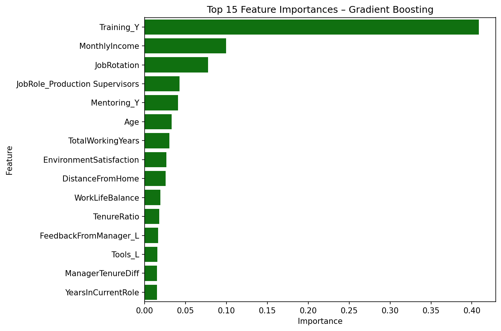
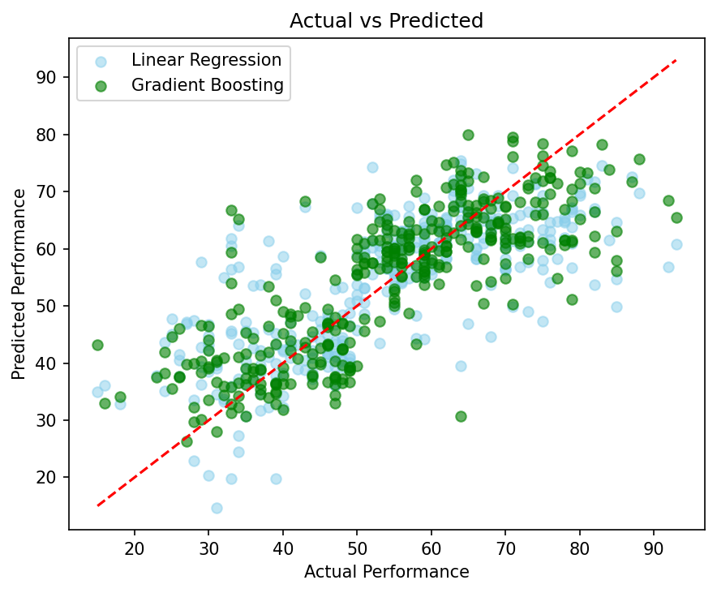

# Employee Performance Prediction – HR Analytics

Predicting employee performance and identifying its key drivers for a mid-sized Australian manufacturer, using Python and machine learning.

## Business problem

Management had noticed low productivity and uneven performance across departments. The goal was to find which demographic, job and engagement factors best predict employee performance (scored 0–100), so HR could target interventions where they matter most.

## Data

- Cleaned HR dataset: **1,201 employees, 30 variables** (1,230 raw records before cleaning)
- Variables cover demographics, job structure, engagement and satisfaction, support and development (training, mentoring, feedback), and pay
- *The dataset was provided for university coursework and is not included in this repository.*

## Approach

1. **Data preparation**: removed the employee ID column (an identifier, not a predictor), fixed an inconsistent department label ("Fin" → "Finance"), and one-hot encoded categorical variables
2. **Baseline model**: Linear Regression on standardised features
3. **Improved model**: Gradient Boosting Regressor (scikit-learn) to capture non-linear effects
4. **Evaluation**: 70/30 train/test split plus 5-fold cross-validation, measured with R², MAE and RMSE

## Results

| Model | Test R² | MAE | RMSE | 5-fold CV R² |
|---|---|---|---|---|
| Linear Regression (baseline) | 0.528 | 8.19 | 10.78 | 0.524 |
| **Gradient Boosting** | **0.632** | **7.23** | **9.52** | **0.634** |

Gradient Boosting explains about 63% of the variation in performance, about 20% more than the baseline, with an average error of about 7 points on a 0–100 scale. Cross-validation closely matches the test score, so the result is stable across different splits of the data.

## Key insights

- **Training is the dominant driver** of performance (about 41% of model importance).
- **Job rotation and mentoring** are the next strongest positive factors.
- **Monthly income** matters in a non-linear way. It ranks highly for Gradient Boosting but has a small linear effect, which helps explain why Gradient Boosting performs better.
- **Low manager feedback** and **Production roles** are associated with lower performance.

**Recommendations:** prioritise access to training, expand mentoring and job rotation (especially in Production), and strengthen manager feedback practices.

## Limitations

- Single-company coursework dataset, so findings may not generalise
- Results show association, not causation
- Model hyperparameters were not tuned

## Tools

Python · pandas · NumPy · scikit-learn · statsmodels · Matplotlib · Seaborn · Google Colab

## Files

- `hr_performance_prediction.ipynb`: full analysis notebook
- `feature_importance.png`, `actual_vs_predicted.png`: charts used in this README
